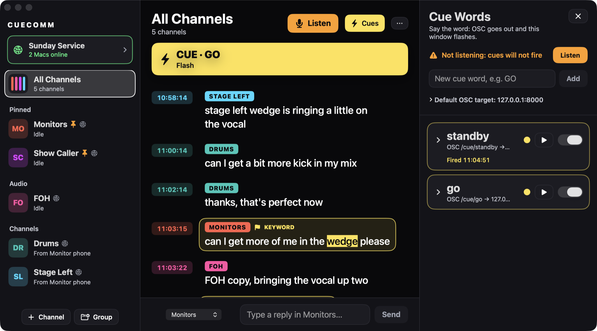

# CueComm

Live-production voice transcription, translation and cues, for Mac and Android.

[Website](https://the13thmoose.github.io/CueComm/) · [Download](https://github.com/The13ThMoose/CueComm/releases/latest) · [Report a problem](https://github.com/The13ThMoose/CueComm/issues)



*The Mac app in a demo session called Sunday Service, with a phone in it. The transcript is demo chatter.*

## What it is

CueComm turns live speech on your production channels into a chat-style transcript (who said what, and when), translates
it, and fires a cue when a chosen word is said: OSC to a lighting or show-control system, and a flash on every Mac and
Android device in the session.

- **Channels** with a colour, group, pin, keywords and a language each. A keyword match is highlighted, and the channel is
  flagged if it arrives while you look elsewhere.
- **Sessions** across Macs and Android devices: devices on one network find each other, and a device on another network or
  subnet **joins by IP address**, landing in that session at once. Each device connects straight to every other one: no
  server, no account.
- **Cue words and automations**: a word sends OSC (UDP) and flashes every screen. Triggers: a word heard, any message, an
  incoming OSC message (and MIDI on a Mac). Actions: send OSC (and MIDI on a Mac), flash, select a channel, scroll, clear,
  mark as read, change the text size.
- **Translation** per channel: Apple's Translation on a Mac with macOS 15 or later, on-device models on Android.
- **Setup files** that the Mac and Android apps both read.

## Download

| | File | Needs |
|---|---|---|
| Mac | [`CueComm.dmg`](https://github.com/The13ThMoose/CueComm/releases/latest/download/CueComm.dmg) | macOS 14 or later, Intel or Apple Silicon. Not notarised: macOS asks you to allow it once. |
| Android | [`CueComm.apk`](https://github.com/The13ThMoose/CueComm/releases/latest/download/CueComm.apk) | Android 8.0 or later. Installs from outside Google Play. |

The [website](https://the13thmoose.github.io/CueComm/) has the install steps for both, with the SHA-256 of each file.
Free during the beta.

## This repository

| Folder | What is in it |
|---|---|
| [`mac/`](mac) | The macOS app: SwiftUI, Swift Package Manager only (Xcode Command Line Tools). |
| [`android/`](android) | The Android app: Kotlin and Jetpack Compose, with a plain-Kotlin core tested on the JVM. |
| [`docs/`](docs) | The website, served by GitHub Pages (English and Norwegian). |
| [`website/`](website) | The scripts and design notes that generate the website. |

### Build

```bash
# Mac (macOS 14+, Xcode Command Line Tools)
cd mac && ./build.sh && open build/CueComm.app      # ./make_dmg.sh makes a disk image

# Android (JDK 17, Android SDK 35)
cd android && ./gradlew :app:testDebugUnitTest :app:assembleRelease

# Website
python3 -I website/build_site.py --dmg CueComm.dmg --apk CueComm.apk --repo The13ThMoose/CueComm
```

## One protocol, two apps

Mac and Android speak the same network protocol: newline-delimited JSON frames over TCP (`hello`, `welcome`, `channels`,
`message`, `history`, `removed`, `cue`), default port 47800. UUIDs are upper case and dates ISO 8601 without fractional
seconds, which is what Swift's `Codable` expects. A listener stays silent until a caller's `hello` carries the right
session name; the one exception is a join request (`hello` with `join: true`), answered with a `welcome` that carries the
session name, so that a device can be joined by typing its address. See `mac/Sources/CueComm/NetworkSync.swift` and
`android/app/src/main/java/no/meltveit/cuecomm/core/NetworkSync.kt`.

## Status

This is a beta.

- Tested: the Mac app on an Apple Silicon Mac; the Android app in an Android 15 emulator; and the two against each other
  over loopback (join by address, channels, history, messages, and a cue flashing the other device), plus 43 JVM tests on
  the Android core.
- Not tested yet: a physical Android phone, an Intel Mac, speech from a real microphone on Android, a real internet
  connection or VPN.
- Android speaks into one channel at a time (the system recogniser uses one microphone); the Mac listens to one input per
  channel. There is no iPhone or iPad version.
- Connections are not encrypted: use a VPN such as Tailscale on networks you do not trust.

## Licence

No licence has been chosen yet. Until one is added the code is visible, but not licensed for reuse.

Made by Meltveit Lydproduksjon. Also from the same maker: [StageTracks](https://the13thmoose.github.io/Stagetracks/),
multitrack backing tracks for live shows on a Mac.
